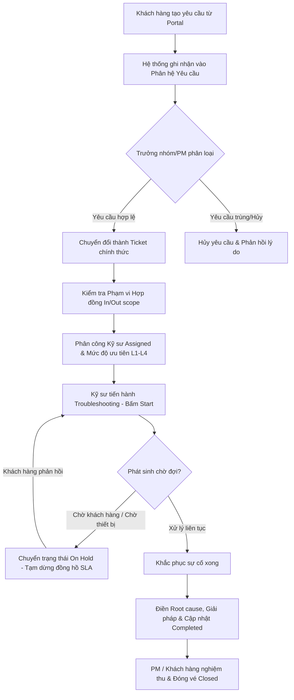

# TÀI LIỆU HƯỚNG DẪN SỬ DỤNG HỆ THỐNG PHẦN MỀM
# JPT HELPDESK & PROJECT MANAGEMENT PORTAL
**Phiên bản hệ thống:** v4.0  
**Đơn vị phát triển:** JPROTECH COMPANY  
**Đối tượng áp dụng:** Ban Giám Đốc, Quản lý Dự án (PM), Đội ngũ Kỹ thuật & Vận hành (Technical Support), Khách hàng Doanh nghiệp (Enterprise Customers).

---

## MỤC LỤC TỔNG QUAN

1. [GIỚI THIỆU TỔNG QUAN HỆ THỐNG](#1-giới-thiệu-tổng-quan-hệ-thống)
2. [CÁC PHÂN QUYỀN VÀ TÀI KHOẢN TRUY CẬP](#2-các-phân-quyền-và-tài-khoản-truy-cập)
3. [HƯỚNG DẪN ĐĂNG NHẬP & GIAO DIỆN CHUNG](#3-hướng-dẫn-đăng-nhập--giao-diện-chung)
4. [HƯỚNG DẪN PHÂN HỆ DASHBOARD (BÁO CÁO & KPI)](#4-hướng-dẫn-phân-hệ-dashboard-báo-cáo--kpi)
5. [HƯỚNG DẪN PHÂN HỆ DỊCH VỤ (SERVICE OPERATIONS)](#5-hướng-dẫn-phân-hệ-dịch-vụ-service-operations)
   - 5.1 [Quản lý Yêu cầu (Requests)](#51-quản-lý-yêu-cầu-requests)
   - 5.2 [Quản lý Ticket Hỗ trợ (Tickets)](#52-quản-lý-ticket-hỗ-trợ-tickets)
   - 5.3 [Quản lý Dịch vụ Bảo trì Định kỳ (Maintenance)](#53-quản-lý-dịch-vụ-bảo-trì-định-kỳ-maintenance)
   - 5.4 [Quản lý Triển khai Dự án (Project Management)](#54-quản-lý-triển-khai-dự-án-project-management)
   - 5.5 [Hệ thống Thông báo (Notifications)](#55-hệ-thống-thông-báo-notifications)
6. [HƯỚNG DẪN PHÂN HỆ THÔNG TIN (MASTER DATA)](#6-hướng-dẫn-phân-hệ-thông-tin-master-data)
   - 6.1 [Quản lý Khách hàng (Customers)](#61-quản-lý-khách-hàng-customers)
   - 6.2 [Quản lý Cơ hội Kinh doanh (Opportunities)](#62-quản-lý-cơ-hội-kinh-doanh-opportunities)
   - 6.3 [Quản lý Danh bạ Liên hệ (Contacts)](#63-quản-lý-danh-bạ-liên-hệ-contacts)
   - 6.4 [Quản lý Hồ sơ Nhân sự (Staff)](#64-quản-lý-hồ-sơ-nhân-sự-staff)
   - 6.5 [Quản lý Hợp đồng Dịch vụ (Contracts)](#65-quản-lý-hợp-đồng-dịch-vụ-contracts)
   - 6.6 [Cấu hình Cam kết Chất lượng Dịch vụ (SLA)](#66-cấu-hình-cam-kết-chất-lượng-dịch-vụ-sla)
7. [HƯỚNG DẪN CỔNG THÔNG TIN KHÁCH HÀNG (CUSTOMER PORTAL)](#7-hướng-dẫn-cổng-thông-tin-khách-hàng-customer-portal)
8. [HƯỚNG DẪN PHÂN HỆ QUẢN TRỊ HỆ THỐNG (ADMINISTRATION)](#8-hướng-dẫn-phân-hệ-quản-trị-hệ-thống-administration)
   - 8.1 [Quản trị Người dùng (Users)](#81-quản-trị-người-dùng-users)
   - 8.2 [Cấu hình Nhóm & Phân quyền (Settings & Groups)](#82-cấu-hình-nhóm--phân-quyền-settings--groups)
   - 8.3 [Sao lưu, Phục hồi & Nhật ký Hệ thống (System & Backup)](#83-sao-lưu-phục-hồi--nhật-ký-hệ-thống-system--backup)
9. [QUY TRÌNH VẬN HÀNH TIÊU CHUẨN (STANDARD OPERATING PROCEDURES - SOP)](#9-quy-trình-vận-hành-tiêu-chuẩn-standard-operating-procedures---sop)
10. [GIẢI ĐÁP CÁC TÌNH HUỐNG THƯỜNG GẶP (FAQ & TROUBLESHOOTING)](#10-giải-đáp-các-tình-huống-thường-gặp-faq--troubleshooting)

---

## 1. GIỚI THIỆU TỔNG QUAN HỆ THỐNG

**JPT Helpdesk Application (v4.0)** là giải pháp phần mềm quản trị tập trung dành cho doanh nghiệp hoạt động trong lĩnh vực dịch vụ công nghệ thông tin, tích hợp hệ thống và bảo trì hạ tầng.

Hệ thống kết nối liền mạch giữa:
* **Khách hàng doanh nghiệp** gửi yêu cầu hỗ trợ và giám sát tiến độ dự án.
* **Đội ngũ Kỹ thuật & IT Helpdesk** xử lý sự cố, triển khai nhiệm vụ kỹ thuật và bảo trì định kỳ.
* **Quản lý Dự án (PM)** điều phối công việc, quản lý mốc thời gian, biểu đồ Gantt và khối lượng công việc.
* **Ban Giám Đốc** theo dõi bức tranh tài chính, tiến độ thực tế, cam kết SLA và mức độ hài lòng của đối tác.

---

## 2. CÁC PHÂN QUYỀN VÀ TÀI KHOẢN TRUY CẬP

Hệ thống áp dụng cơ chế phân quyền dựa trên vai trò (Role-Based Access Control - RBAC) với 4 nhóm người dùng chính:

| Nhóm người dùng | Mã vai trò | Phạm vi chức năng chính | Tài khoản mẫu (Demo) | Mật khẩu mặc định |
| :--- | :--- | :--- | :--- | :--- |
| **Ban Giám Đốc** | `Admin` | Toàn quyền kiểm soát hệ thống: Dashboard tổng thể, Quản lý tài khoản, Phân quyền nhóm, Cấu hình Sao lưu & Khôi phục, Quản lý Danh mục, SLA, Hợp đồng, Dự án. | `admin@jpt.vn` | `123` |
| **Quản lý Dự án** | `PM` | Quản lý dự án (Kế hoạch, Gantt, SOW, Milestone), Quản lý yêu cầu, Phê duyệt ticket, Quản lý Khách hàng, Cơ hội, Hợp đồng và Thông báo. | `pm@jpt.vn` | `123` |
| **Đội Kỹ thuật & Support** | `Technical` | Tiếp nhận và giải quyết Yêu cầu/Ticket, Bấm giờ xử lý/Tạm dừng theo SLA, Thực hiện lịch bảo trì thiết bị và hệ thống định kỳ. | `technical@jpt.vn` | `123` |
| **Khách hàng Doanh nghiệp** | `Customer` | Truy cập riêng biệt vào Cổng dịch vụ Khách hàng (`/portal`): Gửi yêu cầu hỗ trợ mới, tra cứu trạng thái, xem tiến độ dự án, nhận thông báo lịch bảo trì. | `customer@vpbank.vn` | `123` |

---

## 3. HƯỚNG DẪN ĐĂNG NHẬP & GIAO DIỆN CHUNG

### 3.1. Đăng nhập hệ thống
1. Mở trình duyệt web (Google Chrome, Microsoft Edge, Cốc Cốc, Safari...).
2. Truy cập địa chỉ phần mềm: `https://jpt-helpdesk-app.vercel.app/login` (hoặc máy chủ nội bộ công ty).
3. Nhập **Email đăng nhập** và **Mật khẩu**.
4. Nhấn **Đăng nhập**. Hệ thống sẽ tự động điều hướng:
   - Với tài khoản Khách hàng (`Customer`): Chuyển đến màn hình **Customer Portal** (`/portal`).
   - Với tài khoản Nhân sự (`Admin`, `PM`, `Technical`): Chuyển đến màn hình **Dashboard** hoặc danh sách phân hệ được cấp phép.

### 3.2. Cấu trúc Giao diện làm việc chính
* **Thanh điều hướng bên trái (Sidebar Navigation):**
  - **Logo & Thương hiệu JPT Helpdesk**.
  - **Dashboard:** Bảng chỉ số tổng hợp.
  - **Nhóm DỊCH VỤ:** Yêu cầu (kèm huy hiệu số lượng chờ xử lý), Quản lý Ticket, Dịch Vụ Bảo Trì, Triển khai dự án, Thông báo.
  - **Nhóm THÔNG TIN:** Quản Lý Thông Tin (Khách hàng, Cơ hội, Liên hệ, Nhân sự, Hợp đồng), Quản lý SLA.
  - **Nhóm HỆ THỐNG:** Quản lý hệ thống (Người dùng, Phân quyền nhóm, Cấu hình & Sao lưu).
  - **Đăng xuất:** Nút thoát phiên làm việc an toàn ở chân thanh điều hướng.
* **Thanh tiêu đề trên cùng (Header):**
  - Hiển thị tiêu đề phân hệ, thông tin người dùng đang đăng nhập, nút tìm kiếm nhanh, thông báo chuông và menu hồ sơ cá nhân.

---

## 4. HƯỚNG DẪN PHÂN HỆ DASHBOARD (BÁO CÁO & KPI)

Phân hệ **Dashboard** cung cấp bức tranh số liệu thời gian thực giúp lãnh đạo và cấp quản lý ra quyết định kịp thời.

### Các tab báo cáo:
1. **Báo cáo tổng hợp (Synthesis):**
   - Thẻ chỉ số tổng quan: Tổng số Ticket tiếp nhận, Tỷ lệ giải quyết đúng hạn SLA (%), Số dự án đang chạy, Số chu kỳ bảo trì đã hoàn tất.
   - Biểu đồ xu hướng xử lý ticket theo tuần/tháng.
   - Biểu đồ cơ cấu loại yêu cầu (Sự cố mạng, Máy chủ, Cơ sở dữ liệu, Phần mềm...).
2. **Khối lượng công việc nhân sự (Staff Workload):**
   - Theo dõi số lượng ticket và nhiệm vụ dự án đang phân bổ cho từng kỹ sư.
   - Bộ lọc tìm kiếm nhanh nhân sự và lọc theo phòng ban chuyên trách.
   - Cảnh báo các kỹ sư đang quá tải (Overloaded) hoặc có ticket trễ hạn để PM tái phân bổ công việc.
3. **Báo cáo chung (General Incidents):**
   - Phân tích chi tiết các mức độ ưu tiên L1 (Critical), L2 (Major), L3 (Minor), L4 (Warning).
   - Tỷ lệ vi phạm SLA (Breached SLA) và nguyên nhân chính.
4. **Báo cáo bảo trì định kỳ (Maintenance):**
   - Tiến độ thực hiện các chu kỳ bảo trì theo Hợp đồng dịch vụ của từng khách hàng.
5. **Báo cáo triển khai dự án (Deployment):**
   - Tiến độ % các dự án công nghệ, các mốc Milestone sắp đến hạn nghiệm thu.

> **Mẹo sử dụng:** Có thể chuyển đổi bộ lọc thời gian hiển thị **Tuần (Week)**, **Tháng (Month)**, **Năm (Year)** ở góc phải màn hình để xem dữ liệu theo kỳ báo cáo.

---

## 5. HƯỚNG DẪN PHÂN HỆ DỊCH VỤ (SERVICE OPERATIONS)

### 5.1. Quản lý Yêu cầu (Requests)
Là điểm tiếp nhận đầu vào tập trung của toàn bộ yêu cầu phát sinh trước khi chuyển thành Ticket chính thức hoặc phân công nhiệm vụ.

* **3 Tab phân loại:**
  1. **Yêu cầu từ khách hàng (Customer Requests):** Tiếp nhận tự động từ Cổng Portal do đối tác gửi (Mã tiền tố `CR-` hoặc `TH-`).
  2. **Yêu cầu dịch vụ (Service Requests):** Yêu cầu triển khai, thay đổi, cấu hình từ các bộ phận nội bộ.
  3. **Yêu cầu công việc (Task Requests):** Nhiệm vụ kỹ thuật phát sinh đột xuất hoặc phối hợp liên phòng ban.
* **Thao tác chính:**
  - **Tạo yêu cầu mới:** Nhấn nút `+ Tạo yêu cầu` -> Chọn Khách hàng, Hợp đồng, Loại yêu cầu, Người tiếp nhận, Mô tả chi tiết và tệp đính kèm -> Lưu.
  - **Tiếp nhận & Chuyển đổi thành Ticket:** Mở yêu cầu đang ở trạng thái `Chờ tiếp nhận` -> Chọn `Chuyển thành Ticket` -> Hệ thống sẽ tự động điền sẵn thông tin khách hàng, phạm vi hợp đồng sang Ticket Form để tiến hành xử lý kỹ thuật.

---

### 5.2. Quản lý Ticket Hỗ trợ (Tickets)
Là phân hệ lõi điều phối toàn bộ quy trình tiếp nhận, xử lý lỗi kỹ thuật và bảo vệ cam kết SLA dịch vụ.

#### 5.2.1. Vòng đời xử lý chuẩn ITIL (5 bước)
1. **Bước 1 - Tạo Ticket (Create Ticket):** Khởi tạo mã Ticket chuẩn (`TC-YYYYMMDD-XXXX`), nhập tiêu đề sự cố, chọn khách hàng, chọn dịch vụ bị ảnh hưởng.
2. **Bước 2 - Kiểm tra Hợp đồng (Check Contract Scope):**
   - `In scope`: Sự cố nằm trong phạm vi cam kết hợp đồng dịch vụ hiện hữu.
   - `Out scope`: Hạng mục phát sinh ngoài hợp đồng (có thể tính phí bổ sung).
   - `Presale`: Hỗ trợ giai đoạn khảo sát, chuẩn bị đấu thầu.
3. **Bước 3 - Điều phối Nhân sự (Arrange Resource):**
   - Gán **Người xử lý chính (Assigned)** từ danh sách kỹ sư hệ thống.
   - Gán **Người theo dõi (Following)** để cùng nhận thông báo cập nhật.
4. **Bước 4 - Xử lý kỹ thuật (Troubleshooting):**
   - Chuyển trạng thái sang `In progress`.
   - Hệ thống tự động ghi nhận **Thời gian bắt đầu (Start Time)** để đếm ngược SLA.
   - Nếu cần chờ phản hồi từ phía khách hàng hoặc chờ linh kiện phần cứng: Kỹ thuật viên nhấn **Tạm dừng (Hold)**, chọn lý do dừng. Thời gian tạm dừng sẽ được trừ khỏi thời gian xử lý thực tế, bảo vệ không bị tính lỗi vi phạm SLA oan.
   - Khi tiếp tục làm việc: Nhấn **Tiếp tục (Unhold)**.
5. **Bước 5 - Nghiệm thu & Đóng vé (Completed / Closed):**
   - Nhập nguyên nhân gốc rễ (Root Cause), giải pháp khắc phục (Resolution), cập nhật tài liệu Runbook/Onsite (nếu có).
   - Đánh dấu trạng thái `Completed`, gửi thông báo kết quả cho khách hàng.

#### 5.2.2. Bảng quản lý và tùy biến cột (Column Customization)
- Hệ thống hỗ trợ nút **Tùy chỉnh cột (Settings)** trên thanh công cụ bảng Ticket.
- Cho phép người dùng kéo thả để thay đổi vị trí thứ tự hiển thị của các cột thông tin (Mã Ticket, Khách hàng, Trạng thái SLA, Người xử lý, Thời hạn...).
- Hỗ trợ lưu cấu hình cá nhân hoặc khôi phục về mẫu mặc định ban đầu.

---

### 5.3. Quản lý Dịch vụ Bảo trì Định kỳ (Maintenance)
Phục vụ quản lý công tác bảo dưỡng máy chủ, thiết bị mạng, sao lưu cơ sở dữ liệu và bảo trì phần mềm định kỳ theo kỳ hạn trong Hợp đồng dịch vụ.

* **Cấu hình chu kỳ bảo trì:**
  - Hỗ trợ chu kỳ: **Hàng tháng (Monthly)**, **Hàng quý (Quarterly)**, **Hàng năm (Yearly)**.
  - Số lần thực hiện (Cycles) được tính toán tương ứng với thời hạn hợp đồng.
* **Bảng Kế hoạch bảo trì phân cấp:**
  - Mỗi kỳ bảo trì bao gồm các hạng mục công việc cha (Main task) và công việc con (Sub-task): Kiểm tra nguồn điện, kiểm tra logs lỗi, dọn dẹp dung lượng đĩa cứng, nâng cấp bản vá (patching), kiểm tra sao lưu dự phòng.
  - Hệ thống tự động tính tỷ lệ % hoàn thành của kỳ dựa trên số đầu việc con đã được đánh dấu `Hoàn thành`.
* **Trạng thái chu kỳ:**
  - `New`: Chưa đến kỳ thực hiện.
  - `Processing`: Đang trong đợt triển khai bảo trì.
  - `Completed`: Đã hoàn thành 100% các hạng mục và có biên bản nghiệm thu.
  - `On Hold`: Tạm hoãn bảo trì (có thỏa thuận với khách hàng).

---

### 5.4. Quản lý Triển khai Dự án (Project Management - Nổi bật v4.0)
Phân hệ quản lý dự án công nghệ thế hệ mới, hỗ trợ đầy đủ các dự án triển khai hệ thống phần mềm, tích hợp mạng, di trú cơ sở dữ liệu.

#### 5.4.1. Phân loại 4 nhóm dự án
* **Professional Services:** Dự án triển khai giải pháp kỹ thuật theo hợp đồng dịch vụ cho khách hàng.
* **PoC (Proof of Concept):** Dự án thử nghiệm công nghệ, demo giải pháp trước bán hàng.
* **Commercial:** Dự án mua sắm, trang bị thiết bị và bản quyền phần mềm.
* **Internal:** Dự án nâng cấp hạ tầng hoặc phát triển ứng dụng nội bộ công ty JPT.

#### 5.4.2. Chi tiết Dự án & 6 Phân hệ chức năng
Bấm vào một dự án cụ thể để mở màn hình điều hành chi tiết:

1. **Tab Tổng quan (Overview):**
   - Header thông minh hiển thị: % Tiến độ dự án, Chủ nhiệm dự án (PM), Mã dự án, Tên khách hàng, Thời gian thực hiện (Start - End date).
   - Bảng **Phạm vi công việc (Scope of Work - SOW)**: Danh mục các hạng mục cam kết bàn giao và trạng thái nghiệm thu từng mục.
   - Khung **Lưu ý kỹ thuật triển khai**: Các yêu cầu bảo mật nghiêm ngặt (ví dụ: RLS Supabase, tối đa downtime 30 phút, phương án Rollback).
2. **Tab Kế hoạch công việc (Plan) - Cải tiến v4.0:**
   - Cấu trúc công việc dạng cây: **Giai đoạn (Phase)** -> **Công việc chính** -> **Công việc con**.
   - **Tự động tính toán chỉ số Phase thông minh:**
     - % Hoàn thành Phase = Trung bình cộng % các công việc con.
     - Người thực hiện Phase = Danh sách tổng hợp duy nhất từ tất cả nhân sự của các task con.
     - Ngày bắt đầu Phase = Ngày bắt đầu sớm nhất trong các task con.
     - Ngày kết thúc Phase = Ngày kết thúc muộn nhất trong các task con.
     - Ngày kết thúc thực tế = Tự động chốt khi tất cả các task con đều ở trạng thái `Completed`.
   - **Phân công đa nhân sự linh hoạt:** Cho phép chọn nhiều kỹ sư cùng thực hiện một đầu việc từ danh mục Nhân sự hiển thị dạng thẻ tag màu trực quan.
   - **Sắp xếp công việc (Drag & Drop / Direct Move):** Kéo thả chuột trực tiếp hoặc gõ số thứ tự dòng mong muốn để di chuyển nhanh vị trí công việc.
3. **Tab Biểu đồ Gantt (Gantt Chart):**
   - Thiết kế 3 cột chuyên nghiệp:
     + Cột 1: `[Tên công việc]` (hiển thị phân cấp thụt lề rõ ràng).
     + Cột 2: `[Tiến độ % + Thanh Bar trực quan 2 màu]`.
     + Cột 3: `[Lưới thời gian ngày và tháng]`.
   - Grid thời gian hiển thị từng ngày (kèm thứ T2, T3... CN) và tự động tô màu nổi bật **Ngày hôm nay (Today)** để người xem nắm bắt ngay công việc nào đang đúng hạn hay trễ hạn.
   - Thanh Gantt bar mang màu sắc phân biệt sinh động theo từng giai đoạn dự án.
4. **Tab Mốc thời gian (Timeline & Milestones):**
   - Quản lý các mốc quan trọng: Họp khởi động (Kick-off), Hoàn tất thiết kế, Cắt chuyển Go-live, Nghiệm thu sơ bộ, Nghiệm thu chính thức.
5. **Tab Tài liệu dự án (Documents):**
   - Lưu trữ tập trung các hồ sơ dự án: Hợp đồng, Biên bản khảo sát (URD), Thiết kế kiến trúc hệ thống, Báo cáo tiến độ tuần, Biên bản bàn giao.
6. **Tab Nhật ký dự án (Project Diary):**
   - Ghi nhận lịch sử cập nhật hàng ngày: Vấn đề phát sinh (Issue), Giải pháp khắc phục (Resolve), Ý kiến chỉ đạo từ khách hàng và ban lãnh đạo.

---

### 5.5. Hệ thống Thông báo (Notifications)
* Hỗ trợ phát thông báo diện rộng hoặc theo phân vùng đối tượng:
  - **Tab Thông báo khách hàng:** Gửi thông báo đến Cổng Portal của đối tác (Lịch bảo trì, cảnh báo nâng cấp phiên bản hệ thống, thông báo gián đoạn dịch vụ).
  - **Tab Thông báo nội bộ:** Gửi thông báo tới toàn thể cán bộ nhân viên hoặc từng phòng ban (Ban Giám Đốc, Phòng Quản lý dự án, Phòng Kỹ thuật).
  - **Tab Của tôi (For me):** Danh sách các thông báo cá nhân nhận được kèm bộ lọc Đã đọc / Chưa đọc.

---

## 6. HƯỚNG DẪN PHÂN HỆ THÔNG TIN (MASTER DATA)

Tại menu **Quản Lý Thông Tin**, hệ thống tổ chức 5 tab liên kết chặt chẽ với nhau:

### 6.1. Quản lý Khách hàng (Customers)
* Quản lý thông tin doanh nghiệp đối tác: Mã khách hàng, Tên đơn vị, Mã số thuế, Địa chỉ, Đầu mối TTKD phụ trách, Kỹ sư phụ trách chính.
* **Tự động đồng bộ 2 chiều (Auto-sync Google Sheets):**
  - Hệ thống tích hợp tính năng đồng bộ tự động dữ liệu khách hàng từ file Google Sheets định kỳ (mặc định mỗi 15 phút) hoặc bấm nút `Đồng bộ ngay` khi có cập nhật mới.
* **Nhập/Xuất dữ liệu:** Hỗ trợ nhập danh sách khách hàng từ file Excel `.xlsx` và xuất file báo cáo dữ liệu nhanh chóng.

### 6.2. Quản lý Cơ hội Kinh doanh (Opportunities)
* Theo dõi phễu cơ hội (Sales Pipeline): Khảo sát nhu cầu -> Báo giá -> Đấu thầu -> Đàm phán hợp đồng -> Chốt thành công (Won) / Thất bại (Lost).
* Ghi nhận giá trị dự kiến, ngày dự kiến ký hợp đồng, đầu mối phụ trách kinh doanh.

### 6.3. Quản lý Danh bạ Liên hệ (Contacts)
* Quản lý danh bạ cán bộ phụ trách từ phía khách hàng: Họ tên, Chức vụ, Phòng ban, Số điện thoại di động, Email công vụ.
* Mỗi khách hàng có thể có nhiều người liên hệ; khi tạo ticket, hệ thống sẽ gợi ý danh sách người liên hệ tương ứng.

### 6.4. Quản lý Hồ sơ Nhân sự (Staff)
* Danh sách kỹ sư và nhân viên công ty JPT: Mã nhân viên, Họ tên, Phòng ban (Ban Giám Đốc, Phòng Quản lý dự án, Phòng Kỹ thuật & Support), Chức vụ, Số điện thoại, Email, Chuyên môn kỹ thuật.
* Dữ liệu này được kết nối trực tiếp với ô chọn người thực hiện trong Ticket, Dự án và Bảo trì.

### 6.5. Quản lý Hợp đồng Dịch vụ (Contracts)
* Quản lý số hợp đồng, ngày hiệu lực, ngày hết hạn, giá trị hợp đồng, phạm vi dịch vụ (SLA, bảo trì thiết bị, nhân sự tại chỗ Onsite).
* **Cảnh báo hợp đồng hết hạn:** Hệ thống tự động đổi màu cảnh báo đỏ/vàng đối với các hợp đồng đã hết hạn hoặc sắp hết hạn trong vòng 30 ngày, giúp bộ phận kinh doanh và PM kịp thời đàm phán tái tục.
* Hỗ trợ công cụ **Nhập hợp đồng từ Excel** hoặc **Đồng bộ tự động từ Google Drive Sheet**.

### 6.6. Cấu hình Cam kết Chất lượng Dịch vụ (SLA)
* Định nghĩa tiêu chuẩn thời gian xử lý sự cố cho từng khách hàng và từng mức độ nghiêm trọng:
  - **L1 - Khẩn cấp (Critical):** Thời gian phản hồi trong 15 - 30 phút, xử lý trong 2 - 4 giờ.
  - **L2 - Nghiêm trọng (Major):** Thời gian phản hồi trong 1 giờ, xử lý trong 8 giờ.
  - **L3 - Trung bình (Minor):** Thời gian phản hồi trong 2 giờ, xử lý trong 24 giờ.
  - **L4 - Cảnh báo/Tư vấn (Warning):** Thời gian phản hồi trong 4 giờ, xử lý trong 48 giờ.
* Khi Ticket được tạo, hệ thống tự động gán mốc giờ cam kết và cảnh báo nguy cơ vi phạm (Going to breach SLA) để kỹ sư ưu tiên giải quyết.

---

## 7. HƯỚNG DẪN CỔNG THÔNG TIN KHÁCH HÀNG (CUSTOMER PORTAL)

Đường dẫn truy cập: `/portal` (Dành riêng cho đại diện các đối tác, ví dụ: VPBank, ACME Corp...).

### 7.1. Bảng điều khiển Khách hàng (Portal Dashboard)
* Thống kê trực quan số lượng yêu cầu của doanh nghiệp: Yêu cầu đang xử lý, Yêu cầu đã hoàn thành, Chỉ số hài lòng SLA.
* Biểu đồ xu hướng yêu cầu hỗ trợ qua các tháng.

### 7.2. Gửi yêu cầu hỗ trợ mới (Create Request)
1. Bấm nút nổi bật **+ Tạo yêu cầu hỗ trợ** màu xanh tại góc trên màn hình.
2. Nhập các thông tin:
   - **Loại yêu cầu:** Xử lý sự cố, Hỗ trợ kỹ thuật, Thay đổi hệ thống, Yêu cầu bảo dưỡng...
   - **Danh mục:** Phần cứng, Phần mềm, Cơ sở dữ liệu, Mạng kết nối, Bảo mật.
   - **Thời gian phát sinh sự cố & Mức độ ảnh hưởng.**
   - **Mô tả chi tiết:** Hiện tượng lỗi, thông báo lỗi hiển thị trên màn hình.
   - **Tệp đính kèm:** Tải lên ảnh chụp màn hình, file log lỗi hoặc văn bản yêu cầu.
3. Nhấn **Gửi yêu cầu**. Phiếu sẽ lập tức xuất hiện trên màn hình tiếp nhận của Đội Kỹ thuật JPT với trạng thái `Chờ tiếp nhận`.

### 7.3. Theo dõi tiến độ dự án của Khách hàng
* Khách hàng có thể chuyển sang chế độ xem **Theo dõi tiến độ dự án**.
* Xem trực tiếp **Bảng kế hoạch chi tiết** các mốc công việc đang triển khai tại đơn vị mình cùng **Biểu đồ Gantt** trực quan, giúp tăng cường tính minh bạch và uy tín giữa hai bên.

### 7.4. Đọc Thông báo Lịch bảo trì & Bản tin
* Khách hàng xem lịch bảo trì định kỳ sắp tới (thời gian bắt đầu, thời gian kết thúc, mức độ ảnh hưởng dịch vụ, hotline hỗ trợ khẩn cấp) để chủ động kế hoạch nội bộ.

---

## 8. HƯỚNG DẪN PHÂN HỆ QUẢN TRỊ HỆ THỐNG (ADMINISTRATION)

Dành riêng cho quản trị viên cấp cao (`Admin`).

### 8.1. Quản trị Người dùng (Users)
* **Thêm người dùng mới:** Nhấn `+ Thêm tài khoản` -> Nhập Tên, Email, Mật khẩu, Chọn Nhóm quyền (Admin, PM, Technical, Customer), Phòng ban, Số điện thoại.
* **Liên kết Khách hàng / Nhân sự:**
  - Nếu tạo tài khoản Khách hàng (`Customer`), bắt buộc chọn đúng Tên Khách hàng doanh nghiệp để hệ thống tự động lọc dữ liệu riêng biệt theo bảo mật RLS.
  - Nếu tạo tài khoản Kỹ thuật, liên kết với hồ sơ Nhân sự để đồng bộ tên và phòng ban.
* **Khóa / Mở khóa tài khoản:** Bấm vào biểu tượng ổ khóa để tạm ngưng quyền truy cập của nhân sự nghỉ việc mà không làm mất dữ liệu lịch sử.
* **Đặt lại mật khẩu (Reset Password):** Đặt lại mật khẩu nhanh cho người dùng khi quên mật khẩu.

### 8.2. Cấu hình Nhóm & Phân quyền (Settings & Groups)
* Cho phép xem danh sách các Nhóm người dùng (Ban Giám Đốc, Quản lý Dự án, Đội Kỹ thuật & Support, Khách hàng Doanh nghiệp).
* Tích chọn hoặc bỏ chọn từng màn hình/đường dẫn phân hệ (`/dashboard`, `/requests`, `/tickets`, `/maintenance`, `/projects`, `/system`...) để cấp phát hoặc thu hồi quyền truy cập của nhóm đó.

### 8.3. Sao lưu, Phục hồi & Nhật ký Hệ thống (System & Backup)
* **Tab Ứng dụng (App):** Thông tin phiên bản `v4.0.0`, trạng thái máy chủ, trạng thái kết nối Database Supabase.
* **Tab Cơ sở dữ liệu (Database):**
  - **Sao lưu (Backup):** Xuất toàn bộ dữ liệu hệ thống (Tickets, Khách hàng, Hợp đồng, Dự án, Nhân sự) thành tệp JSON hoặc bảng tính an toàn về máy.
  - **Phục hồi (Restore):** Khôi phục dữ liệu từ tệp sao lưu khi có sự cố.
  - **Dọn dẹp dữ liệu trùng lặp (Cleanup duplicates):** Quét và loại bỏ các bản ghi trùng lặp đảm bảo tính toàn vẹn của cơ sở dữ liệu.
* **Tab Lưu trữ (Storage):**
  - Cấu hình nơi lưu trữ tệp đính kèm: Google Drive, Cloudflare R2 hoặc Supabase Storage.
  - Kiểm tra kết nối lưu trữ đám mây.
* **Tab Nhật ký hoạt động (Audit Logs):**
  - Ghi nhận chi tiết mọi thao tác nhạy cảm: Ai đã tạo/sửa/xóa ticket nào, lúc mấy giờ, từ địa chỉ IP nào.

---

## 9. QUY TRÌNH VẬN HÀNH TIÊU CHUẨN (STANDARD OPERATING PROCEDURES - SOP)

### 9.1. Quy trình 1: Tiếp nhận và xử lý sự cố khẩn cấp (L1 - Critical)
1. **Bước 1:** Khi có yêu cầu hoặc cảnh báo sự cố L1 (Hệ thống ngân hàng gián đoạn, sập máy chủ database):
   - Kỹ sư trực ca lập tức chuyển trạng thái sang `In progress`.
   - Hệ thống tự động kích hoạt đồng hồ đếm ngược SLA (Thời gian xử lý tối đa 2 giờ).
2. **Bước 2:** Kỹ sư phối hợp với khách hàng kiểm tra logs, định vị nguyên nhân.
3. **Bước 3:** Trong trường hợp phải chờ khách hàng cung cấp quyền truy cập máy chủ (VPN / Firewall), kỹ sư phải chọn trạng thái `On Hold` và chọn lý do `Chờ khách hàng mở VPN` để hệ thống dừng tính giờ SLA.
4. **Bước 4:** Sau khi phục hồi dịch vụ, chuyển sang `Completed`, đính kèm biên bản xử lý sự cố.

### 9.2. Quy trình 2: Lập và điều hành Kế hoạch Triển khai Dự án
1. **Bước 1:** PM tạo dự án mới tại phân hệ `Triển khai dự án` -> Chọn khách hàng, loại dự án, gán thời gian bắt đầu - kết thúc.
2. **Bước 2:** Vào tab `Kế hoạch (Plan)` -> Thêm các Giai đoạn (Phase 1, Phase 2, Phase 3).
3. **Bước 3:** Thêm các công việc con trong từng Phase -> Gán nhân sự chịu trách nhiệm (hỗ trợ chọn nhiều kỹ sư) -> Nhập ngày bắt đầu, ngày kết thúc.
4. **Bước 4:** Kiểm tra tính logic trên **Biểu đồ Gantt**.
5. **Bước 5:** Hàng tuần, kỹ sư vào cập nhật % tiến độ thực tế. Hệ thống tự động đẩy % hoàn thành lên cấp Phase và cấp Dự án.

---

## 10. GIẢI ĐÁP CÁC TÌNH HUỐNG THƯỜNG GẶP (FAQ & TROUBLESHOOTING)

### Q1: Tại sao Kỹ sư không nhìn thấy nút Cấu hình hệ thống và Phân quyền?
* **Trả lời:** Các tính năng này được phân quyền độc quyền cho tài khoản `Admin` (Ban Giám Đốc). Tài khoản `Technical` chỉ có quyền truy cập Dashboard, Yêu cầu, Ticket và Lịch bảo trì.

### Q2: Làm sao để bảo vệ SLA khi khách hàng phản hồi chậm?
* **Trả lời:** Kỹ sư mở Ticket đó lên, chuyển trạng thái sang `On Hold`, chọn lý do `Chờ phản hồi từ khách hàng` hoặc `Chờ phê duyệt bảo trì`. Hệ thống sẽ tạm dừng tính thời gian xử lý và lưu vết thời điểm tạm dừng. Khi khách hàng phản hồi, chỉ cần chuyển lại `In progress` để tiếp tục làm việc.

### Q3: Khi chuyển đổi vị trí công việc trong Kế hoạch dự án có bị mất dữ liệu không?
* **Trả lời:** Không. Phiên bản 4.0 hỗ trợ cả 2 phương thức: kéo thả chuột trực tiếp và gõ số thứ tự dòng mong muốn (Direct move input). Dữ liệu được lưu trữ an toàn tức thì lên máy chủ cơ sở dữ liệu Supabase.

### Q4: Làm thế nào để đồng bộ dữ liệu mới nhất từ Google Sheets?
* **Trả lời:** Tại các màn hình Khách hàng, Cơ hội hoặc Hợp đồng, nhấn vào nút **Đồng bộ ngay (Refresh icon)** ở thanh công cụ. Hệ thống sẽ kết nối qua API Google Sheets và cập nhật các dòng thay đổi trong vòng vài giây.

---
*Tài liệu được biên soạn và chuẩn hóa bởi Đội ngũ Kỹ thuật JPT Helpdesk - JPROTECH COMPANY.*  
*Mọi thắc mắc kỹ thuật xin vui lòng liên hệ Ban Quản trị Hệ thống qua email: `admin@jpt.vn`.*
